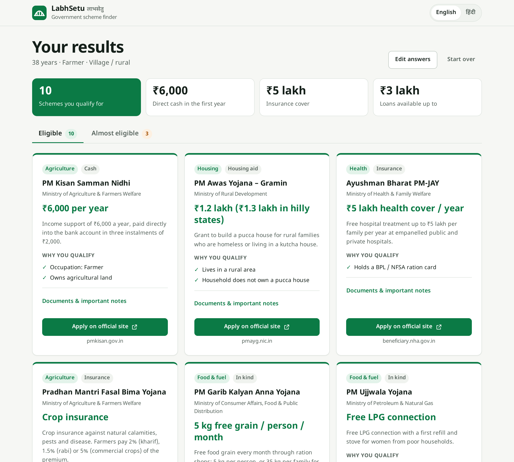
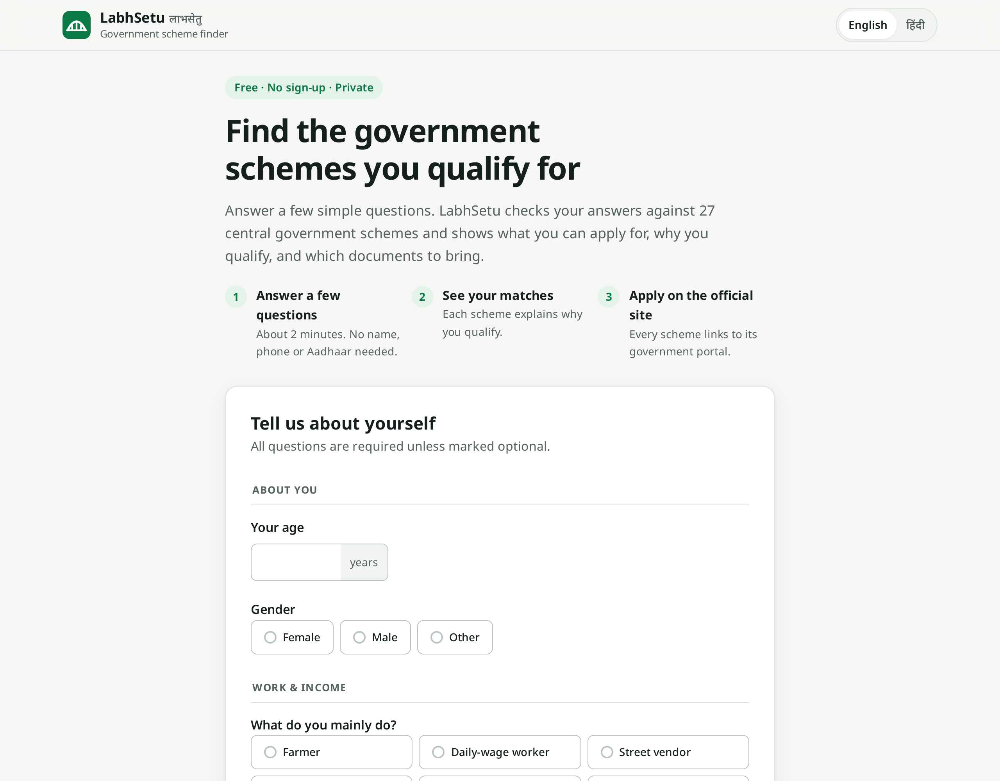
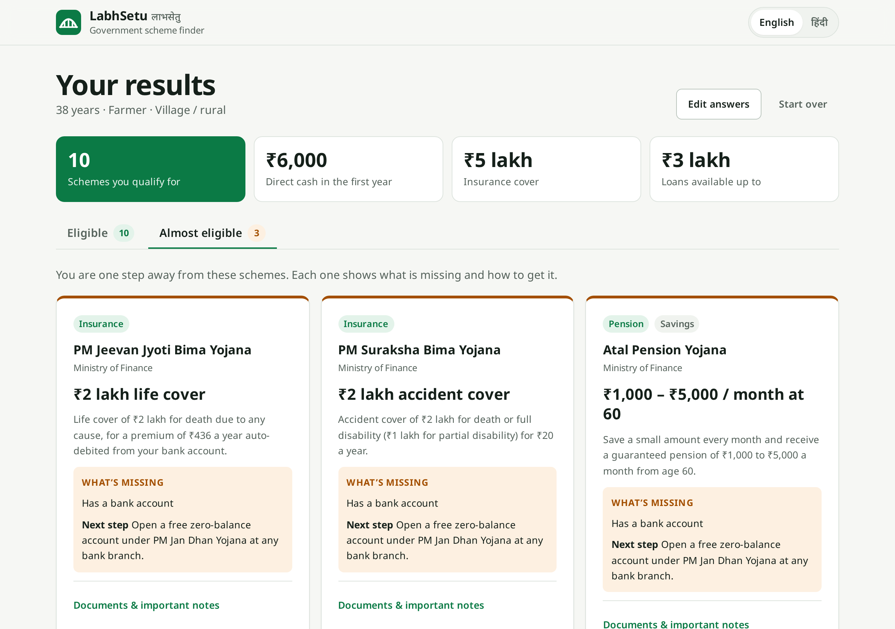
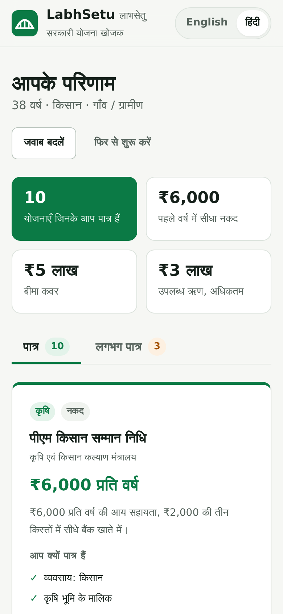
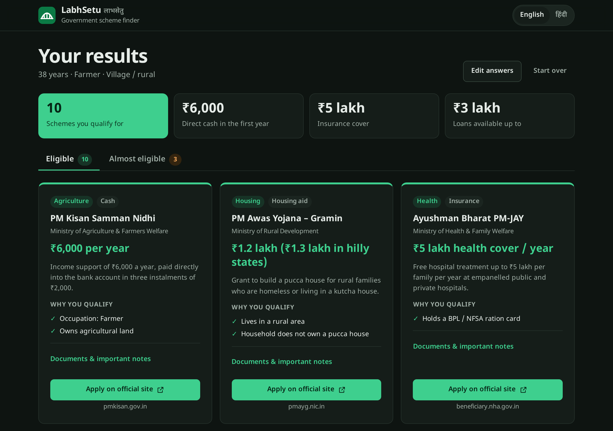
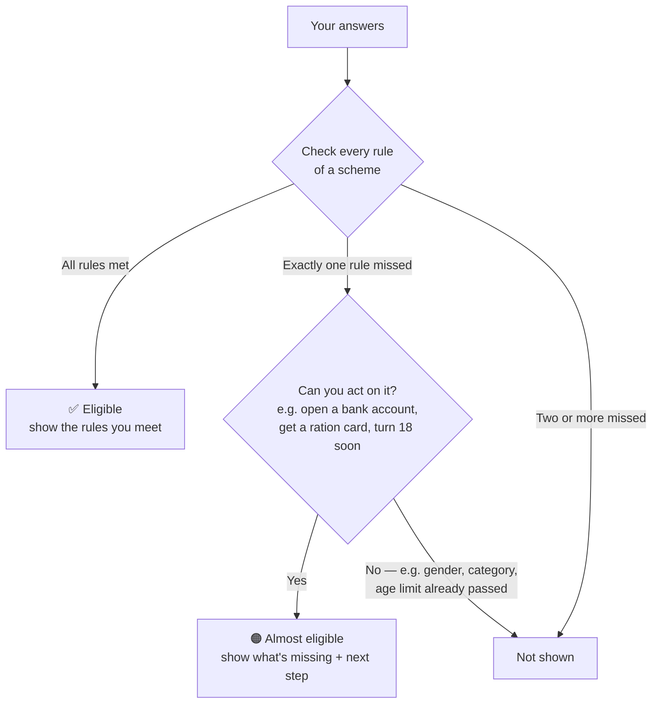
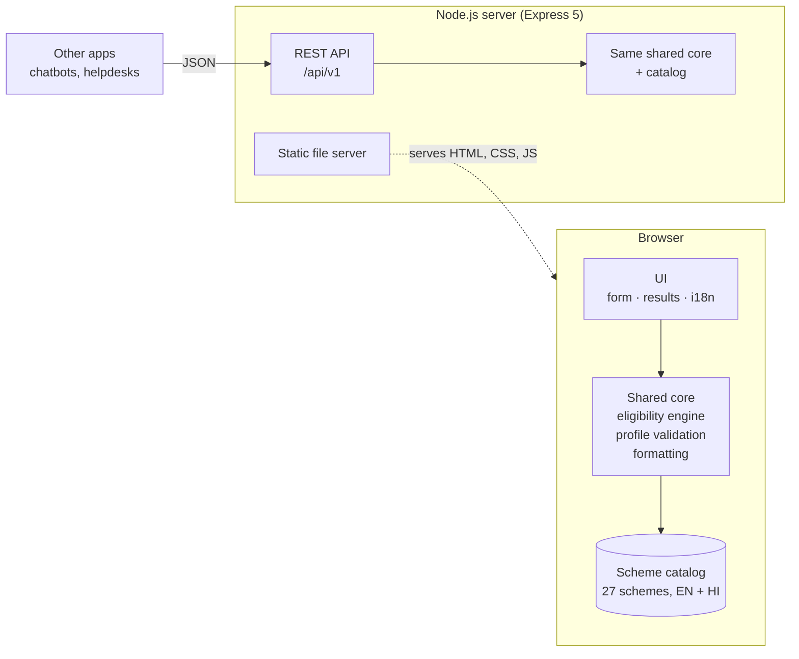

<div align="center">


# LabhSetu · लाभसेतु

**Find the Indian government schemes you qualify for, in about two minutes.**

Free · No sign-up · Private by design · English and हिंदी

[](https://github.com/sakshamg251206/Janvitta/actions/workflows/ci.yml)

[](LICENSE)



</div>

---

## What is this?

India runs hundreds of welfare schemes: cash support for farmers, free health insurance, pensions, scholarships, housing grants, low-interest loans. Many of the people they are meant for never apply. They don't know a scheme exists, can't tell whether they qualify, or can't find out where to apply.

**LabhSetu** (_labh_ = benefit, _setu_ = bridge) is a simple website that closes that gap. You answer a few plain questions about yourself, such as age, work, family income and where you live. It then shows you:

- ✅ **which schemes you qualify for**, and _why_, in plain language;
- 🟠 **which schemes you are one step away from**, and the practical next step (for example, “open a free Jan Dhan bank account”);
- 📄 **which documents to bring** and any important exclusions;
- 🔗 **a direct link to the official government portal** to apply.

It needs no name, phone number or Aadhaar. The check runs entirely in your browser, so **your answers are never sent anywhere**.

> **Important:** LabhSetu is an independent project and is not affiliated with the Government of India. Its rules are a simplified guide to each scheme; the official portal always has the final word.

## Who is it for?

- **Citizens and families** who want to know what support they can claim.
- **Helpers:** Common Service Centre operators, NGO field workers, ASHA and Anganwadi workers, students running awareness drives. They can check eligibility with someone in a couple of minutes, on a basic phone.
- **Developers and organisations** who want the same eligibility logic through a small JSON API, for example inside a chatbot or helpdesk tool.

## Screenshots

| Profile form                                                                                                                       | “Almost eligible” with next steps                                                                                                            |
| ---------------------------------------------------------------------------------------------------------------------------------- | -------------------------------------------------------------------------------------------------------------------------------------------- |
|  |  |

| Hindi, on a phone                                                                                              | Dark mode                                                                                    |
| -------------------------------------------------------------------------------------------------------------- | -------------------------------------------------------------------------------------------- |
|  |  |

## Features

- **27 central government schemes** across agriculture, housing, health, women and children, education, insurance, pensions, food and fuel, jobs and skills, business loans, disability and banking.
- **Explained results.** Every match lists the exact conditions you meet, for example “Occupation: Farmer” and “Owns agricultural land”.
- **Useful “almost eligible” list.** It only lists schemes where the one missing condition is something you can actually act on, such as opening a bank account, applying for a ration card, or turning 18 soon. It never lists conditions you can't change.
- **Honest totals.** Cash payments, insurance cover and loan limits are shown separately, never added together into one inflated number.
- **Bilingual.** Full English and Hindi, including scheme content and explanations. Remembers your choice.
- **Private.** Matching happens on your device. The page makes no API calls while you use it, and the server never logs request bodies.
- **Accessible and mobile-first.** Works with keyboard and screen readers, allows zoom, has large touch targets, respects reduced-motion and dark-mode settings, and prints cleanly to take to a service centre.
- **REST API** with the same engine, for integrations.

## How it works

The heart of the project is a small **eligibility engine** and a **scheme catalog**. Each scheme's rules are written as data, not code:

```js
// Stand-Up India: business owners aged 18+ who are SC/ST *or* women
criteria: {
  minAge: 18,
  occupation: ['business'],
  anyOf: [{ caste: ['sc', 'st'] }, { gender: ['female'] }],
}
```

The engine checks a profile against each scheme and sorts it into one of three outcomes:



Both the website and the API import **the same engine and the same catalog**, so they always give identical answers.

## Architecture



- **The website is static.** HTML, CSS and native ES modules, with no framework and no build step. Once loaded, it works without the server.
- **The server** serves those files with strict security headers and exposes the engine as a JSON API.
- **The shared core** (`frontend/scripts/core/` and `frontend/scripts/data/`) is pure JavaScript with no DOM or Node APIs. It runs unchanged in both places.

## Tech stack

| Layer    | Choice                                                                 | Why                                                          |
| -------- | ---------------------------------------------------------------------- | ------------------------------------------------------------ |
| Frontend | HTML, CSS, vanilla JavaScript (ES modules)                             | Fast on low-end phones and slow networks; nothing to compile |
| Backend  | Node.js 22, Express 5                                                  | Small, well-known, async error handling built in             |
| Security | Helmet (CSP and security headers), express-rate-limit, CORS allow-list | Sensible defaults for a public API                           |
| Types    | JSDoc and TypeScript `checkJs`                                         | Type safety without a build step                             |
| Tests    | `node:test` (unit and API), Playwright (browser, desktop and mobile)   | Built-in runner; real-browser checks for the UI              |
| Quality  | ESLint, Prettier, GitHub Actions, Dependabot                           | Every push is linted, type-checked and tested                |
| Deploy   | Docker (Node 22 Alpine, non-root) or any static host                   | Runs anywhere                                                |

## Project structure

```
.
├── frontend/                    # The website (served as-is)
│   ├── index.html
│   ├── favicon.svg
│   ├── styles/                  # base (tokens, layout) · components · results
│   └── scripts/
│       ├── app.js               # Entry point: wires form, results, language, sharing
│       ├── core/                # ⚙ Shared with the API: pure, DOM-free
│       │   ├── eligibility.js   #   Rules engine, explanations, totals
│       │   ├── profile.js       #   Questions, allowed answers, validation
│       │   └── format.js        #   ₹ formatting (lakh / crore), list joining
│       ├── data/
│       │   └── schemes.js       # ⚙ Shared: the scheme catalog (EN + HI)
│       └── ui/                  # Browser-only views
│           ├── form.js
│           ├── results.js
│           └── i18n.js          #   Interface strings (EN + HI)
├── backend/
│   ├── server.js                # Process entry: start, graceful shutdown
│   ├── app.js                   # Express app: security, API, static files
│   ├── config.js                # Environment variables, validated at startup
│   ├── http-error.js
│   ├── routes/schemes.js        # /api/v1 endpoints
│   └── middleware/errors.js     # Consistent JSON errors
├── tests/
│   ├── unit/                    # Engine, validation, formatting, catalog integrity
│   ├── api/                     # HTTP behaviour, headers, errors, CORS, rate limits
│   └── e2e/                     # Playwright: real user flows on desktop and mobile
├── docs/screenshots/
├── .github/                     # CI workflow, Dependabot
├── Dockerfile
└── .env.example
```

## Getting started

You need **Node.js 22 or newer** ([download](https://nodejs.org/)).

```bash
git clone https://github.com/sakshamg251206/Janvitta.git
cd Janvitta
npm install
npm start
```

Open **http://localhost:3000**. No database or API keys are needed.

For development, `npm run dev` restarts the server when files change.

### Environment variables

Everything is optional. Copy `.env.example` to `.env` to change a setting; `npm start` and `npm run dev` load it automatically.

| Variable               | Default       | Purpose                                                                                               |
| ---------------------- | ------------- | ----------------------------------------------------------------------------------------------------- |
| `NODE_ENV`             | `development` | `production` turns on static-file caching and HTTPS upgrade in the CSP                                |
| `HOST`                 | `0.0.0.0`     | Interface to listen on                                                                                |
| `PORT`                 | `3000`        | Port to listen on                                                                                     |
| `CORS_ORIGINS`         | _(empty)_     | Comma-separated origins allowed to call the API from other sites; empty = same-origin only; `*` = any |
| `RATE_LIMIT_WINDOW_MS` | `60000`       | Rate-limit window for `/api/v1`                                                                       |
| `RATE_LIMIT_MAX`       | `60`          | Requests per window per client IP                                                                     |
| `TRUST_PROXY`          | `false`       | Set to `1` behind a reverse proxy or load balancer so client IPs are correct                          |

Invalid values stop the server at startup with a clear message, rather than failing later.

## API

Base path: `/api/v1`. Add `?lang=hi` to any endpoint for Hindi text.

| Method | Endpoint                | Description                                       |
| ------ | ----------------------- | ------------------------------------------------- |
| `GET`  | `/schemes`              | List all schemes (filter with `?category=health`) |
| `GET`  | `/schemes/:id`          | One scheme, e.g. `/schemes/pm-kisan`              |
| `POST` | `/eligibility`          | Match a profile against every scheme              |
| `GET`  | `/health` _(no prefix)_ | Liveness check                                    |

**Example**

```bash
curl -X POST http://localhost:3000/api/v1/eligibility \
  -H 'content-type: application/json' \
  -d '{
    "age": 42, "gender": "female", "annualIncome": 150000,
    "occupation": "farmer", "caste": "obc", "area": "rural",
    "ownsFarmland": true, "hasBankAccount": true
  }'
```

```jsonc
{
  "catalogVersion": "2026.10",
  "summary": {
    "eligibleCount": 8,
    "almostCount": 3,
    "firstYearCash": 6000,
    "insuranceCover": 400000,
    "maxLoan": 300000,
  },
  "eligible": [
    {
      "id": "pm-kisan",
      "name": "PM Kisan Samman Nidhi",
      "benefit": { "type": "cash", "label": "₹6,000 per year", "amount": 6000, "period": "year" },
      "reasons": ["Occupation: Farmer", "Owns agricultural land"],
      "documents": ["Aadhaar card", "Land records", "Bank passbook"],
      "applyUrl": "https://pmkisan.gov.in",
      // …
    },
  ],
  "almost": [
    {
      "id": "ayushman-bharat",
      "missing": "Any one of: Holds a BPL / NFSA ration card; Aged 70 or older",
      "nextStep": "Your income may qualify you for a priority-household (NFSA) ration card — ask at your local ration office.",
    },
  ],
}
```

**Profile fields:**

- **Required:**
  - `age` (0–120)
  - `annualIncome` (whole rupees)
  - `gender`: `female` · `male` · `other`
  - `occupation`: `farmer` · `wage_worker` · `street_vendor` · `artisan` · `business` · `salaried` · `student` · `unemployed` · `other`
  - `caste`: `general` · `obc` · `sc` · `st`
  - `area`: `rural` · `urban`
- **Optional yes/no (default `false`):** `hasBankAccount`, `hasBplCard`, `ownsFarmland`, `ownsPuccaHouse`, `hasDisability`, `hasDaughterUnder10`, `isPregnant`.

**Errors** always look like `{ "error": { "code", "message", "details?" } }`:

| Status | Code                | When                           |
| ------ | ------------------- | ------------------------------ |
| 400    | `INVALID_JSON`      | Body isn't valid JSON          |
| 400    | `INVALID_QUERY`     | Bad `lang` or `category`       |
| 404    | `NOT_FOUND`         | Unknown scheme or route        |
| 413    | `PAYLOAD_TOO_LARGE` | Body over 10 KB                |
| 422    | `VALIDATION_ERROR`  | `details` lists each bad field |
| 429    | `RATE_LIMITED`      | Too many requests              |

## Testing

```bash
npm test               # unit + API tests (node:test)
npm run test:e2e       # browser tests (Playwright, desktop + mobile)
npm run lint           # ESLint
npm run typecheck      # TypeScript checking of the JSDoc-typed JavaScript
npm run check          # lint + format check + typecheck + unit/API tests
```

The first time you run browser tests, install a browser with `npx playwright install chromium`.

What the tests cover:

- **Engine:** boundary values for age and income, “any one of” rules, the “almost eligible” policy, totals that never mix cash with loans, and regression tests for bugs fixed in the rewrite.
- **Catalog integrity:** unique ids, known rule keys and documents, `https` links, and complete English and Hindi text for every scheme and UI string.
- **API:** responses, validation errors, malformed and oversized bodies, security headers, CORS allow-list and rate limiting.
- **Browser:** the full form-to-results flow, accessible error messages, keyboard-operable tabs, language switching and persistence, conditional questions, no network calls during matching, and no horizontal scrolling on mobile.

CI runs all of this on every push and pull request, and also builds and smoke-tests the Docker image.

## Deployment

**Docker** (any container host: Render, Railway, Fly.io, Cloud Run, a VPS):

```bash
docker build -t labhsetu .
docker run -p 3000:3000 -e TRUST_PROXY=1 labhsetu
```

The image runs as a non-root user and has a built-in health check on `/health`.

**Node platforms without Docker** (Render, Railway and similar): build command `npm ci --omit=dev`, start command `npm start`. Set `NODE_ENV=production`, and `TRUST_PROXY=1` if the platform puts a proxy in front of your app.

**Static hosting only** (GitHub Pages, Netlify, Cloudflare Pages): publish the `frontend/` folder as-is. The website works fully without the server, because matching runs in the browser. You lose the API, and should configure security headers on the host.

## Technical decisions

- **One catalog, one engine, used everywhere.** The original version had two scheme lists and two matching engines (one in the browser, one on the server) that had drifted apart and gave different answers. Now there is one source of truth, imported by both.
- **Rules as data.** Scheme criteria are declarative objects, not `if` statements. Adding or fixing a scheme is a data edit that the catalog tests validate automatically.
- **Matching in the browser.** The people this is for may be sharing a phone or using a slow connection, and are often (rightly) wary of giving personal details to websites. Matching locally makes results instant and keeps answers on the device.
- **No database.** The catalog is a few dozen records that change a few times a year. Keeping it in version control gives review, history and tests for every change, and nothing to provision. A database becomes worthwhile only if the data needs non-developer editing or per-user storage.
- **No frontend framework or build step.** The UI is one form and one results page. Native ES modules keep the page light, simple to host anywhere, and easy for contributors to read.
- **No accounts.** The original had a half-finished login system. Since the product promise is “no sign-up” and nothing needs to be saved, it was removed rather than completed.
- **No document uploads.** An earlier prototype had endpoints to upload Aadhaar cards and bank statements and send their contents to a third-party API. They were never connected to the UI and conflicted with the privacy promise, so they were removed.
- **“Almost eligible” only when actionable.** Telling a 25-year-old they “almost” qualify for an old-age pension is noise. A near miss counts only if the person can do something about it, and the result says what.
- **Separate totals.** A ₹1 crore loan limit is not money received. Cash, insurance cover and loan limits are reported separately to avoid overstating benefits.

## Limitations and future work

- **Central schemes only.** States run many more schemes, often with larger benefits. State-specific schemes need a state question and a much larger catalog.
- **Simplified rules.** Real eligibility can depend on things the app doesn't ask (income-tax status, EPFO membership, survey lists such as SECC). These are shown as notes on each scheme instead of being guessed.
- **Data needs upkeep.** Amounts and rules change with budgets and new guidelines. Each entry links to its official portal, but the catalog should be reviewed regularly; see [CONTRIBUTING.md](CONTRIBUTING.md).
- **English and Hindi only.** The translation structure supports more languages (Bengali, Marathi, Tamil, Telugu and others would widen reach).
- **No offline install yet.** The site is small and works on slow connections, but a service worker would let it work fully offline once visited.

## Contributing

Corrections to scheme data are especially welcome. See [CONTRIBUTING.md](CONTRIBUTING.md) for setup, the rule format, and how to add a scheme.

## License

[MIT](LICENSE) © Saksham Garg
